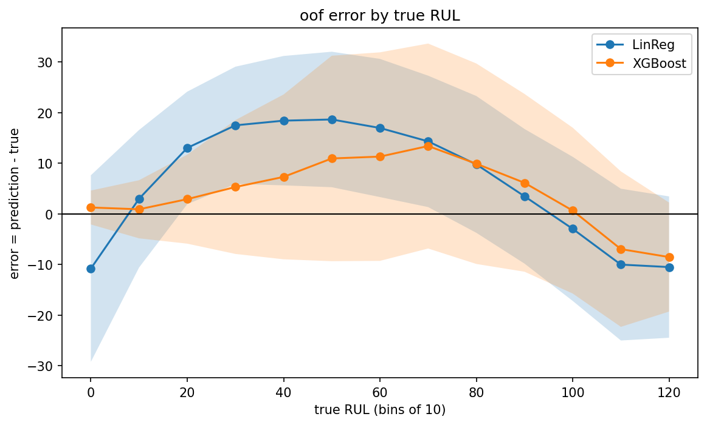
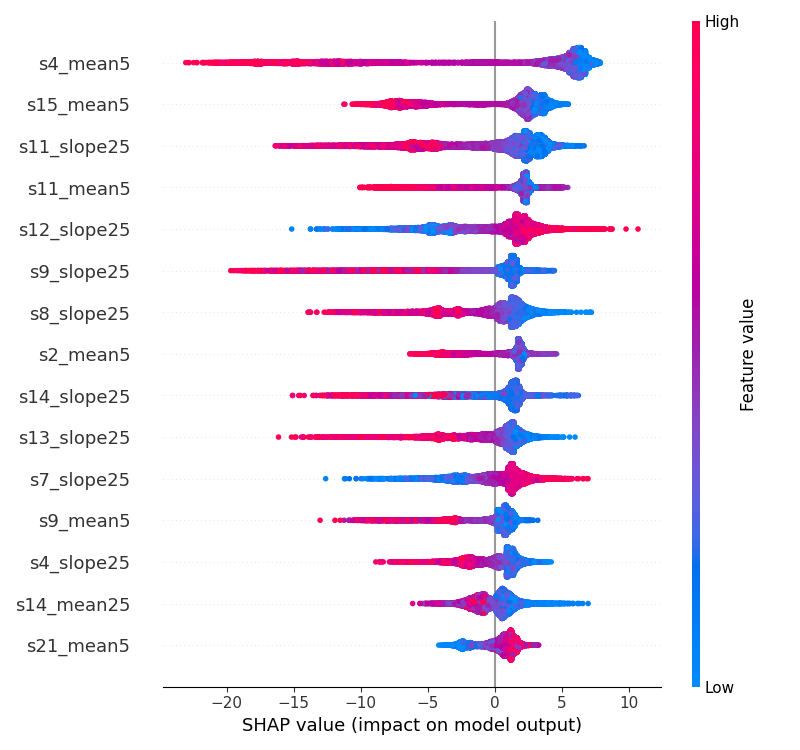
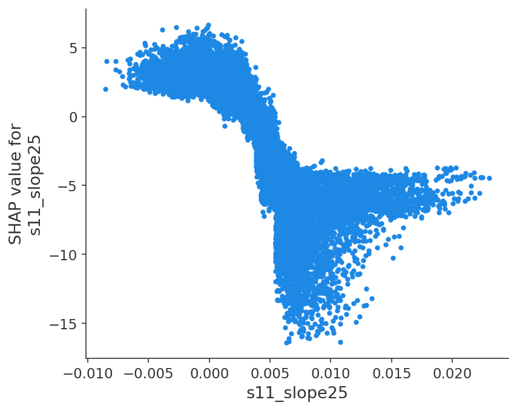

# Turbofan RUL Prediction – NASA C-MAPSS FD001


Predicting the remaining useful life (RUL) of turbofan engines from sensor data, with the focus on a clean process: a written hypothesis before every run, one change per run, engine-wise cross-validation, and a test set that was opened exactly once.

> **Kurzfassung (Deutsch):** Vorhersage der Restlebensdauer (RUL) von Flugzeugtriebwerken auf dem NASA-Datensatz C-MAPSS FD001. Im Fokus steht das Vorgehen: vor jedem Lauf eine Hypothese mit Zahl, eine Änderung pro Lauf, Kreuzvalidierung nach Triebwerk und ein Testset, das genau einmal ausgewertet wurde. Das finale Modell (LightGBM mit Standardparametern, 98 Features aus gleitenden Mittelwerten und Steigungen) erreicht im Test einen RMSE von 13,00 Zyklen, in der Kreuzvalidierung 13,24. Widerlegte Hypothesen sind mit Mechanismus dokumentiert, z. B. die Normalisierung je Triebwerk und der Nutzen des Tunings. 60 % der Testvorhersagen sind zu spät (höchstens 30 Zyklen), deshalb ist der nächste Schritt eine Entscheidungsebene mit Unsicherheit und Wartungskosten.

## Key results

| | |
|---|---|
| Final model | LightGBM, default parameters, 98 features |
| CV RMSE (10-fold GroupKFold by engine) | 13.24 cycles |
| **Test RMSE** (100 engines, last cycle, uncapped) | **13.00 cycles** (capped at 125: 11.79) |
| Test NASA score (mean / sum) | 2.48 / 248.2 |
| Late predictions on test | 60 %, at most 30 cycles late |
| Quality checks | 5 `pytest` tests incl. leakage checks, run on every push |

The notebooks are commented in German. This README summarises them in English.

## 1. Problem and maintenance context

The task is to predict, for every engine and every operating cycle, how many cycles remain until failure. The prediction feeds a maintenance decision: when to take the engine out of service.

**Error convention used throughout:** error = predicted RUL − true RUL. A positive error is **late** (RUL overestimated, maintenance too late). A negative error is **early** (RUL underestimated, maintenance too early).

The two errors do not cost the same. Late is a safety risk, early only costs money. The NASA scoring function reflects this with an asymmetric exponential penalty per prediction (d = error):

$$s = \begin{cases} e^{-d/13} - 1 & d < 0 \text{ (early)} \\ e^{d/10} - 1 & d \geq 0 \text{ (late)} \end{cases}$$

30 cycles late costs 19.1, 30 cycles early costs 9.1.

**"Better" depends on the metric.** On the single-row baseline (step a in section 3), XGBoost has about 11 % lower RMSE than linear regression (19.23 vs. 21.56), but about twice the NASA score (18.77 vs. 9.51). Both models are almost unbiased on average. The difference comes from outliers: XGBoost's largest late error per fold is about 24 cycles larger (77.0 vs. 53.1). This is why I use RMSE as a hurdle and the NASA score to decide between candidates (section 2), and why the roadmap includes a decision layer (section 11).

Details: [`03_validation.ipynb`](notebooks/03_validation.ipynb)

## 2. Data and validation setup

- **Train:** 100 engines run to failure, 20,631 rows, lifetimes 128–362 cycles.
- **Test:** 100 other engines, cut off at a random point (31–303 observed cycles). The true RUL at the last observed cycle is given in `RUL_FD001.txt` (7–145 cycles). Only this last cycle is scored, so the test consists of 100 predictions.
- **Sensors:** FD001 has one operating condition. I removed the three operating settings and seven constant or near-constant sensors (`s1`, `s5`, `s6`, `s10`, `s16`, `s18`, `s19`), which leaves 14 sensors.
- **RUL capped at 125** (piecewise-linear target): early in life the sensors are flat, and trends only become visible from about RUL 125 ([`01_eda.ipynb`](notebooks/01_eda.ipynb)). Without the cap, the model would have to tell RUL 300 from RUL 200 without any signal. With the cap, **39.4 % of the training rows** sit on the plateau (8,131 = 20,631 − 100 × 125, because every engine lives at least 128 cycles). In the test set, only 11 of 100 engines have a true RUL above 125. This difference matters in section 7.

**Validation: `GroupKFold(n_splits=10)` by engine.** Consecutive cycles of one engine are almost identical. Plain KFold would put neighbouring cycles of the same engine into train and validation, and the validation error would be too optimistic. GroupKFold keeps every engine entirely on one side, as in deployment.

**Paired comparisons:** all runs use the same 10 splits, so two variants can be compared fold by fold. This is more informative than mean ± std when the spread across folds is as large as the effect.

**Metrics:** RMSE is the hurdle, the NASA score (mean per prediction) decides between candidates. On the test set I also report the NASA sum for comparison with published results.

**CV and test are not directly comparable:** the CV scores every cycle, the test only the last cycle of truncated engines (see section 7).

**Test set used once:** all feature and model decisions were made on the CV, the test set was opened once in [`06_final_model.ipynb`](notebooks/06_final_model.ipynb). One honest exception: the very first baseline ([`02_baseline.ipynb`](notebooks/02_baseline.ipynb)) was evaluated on the test set once (linear regression 21.90, XGBoost 18.18), before the "test exactly once" rule was introduced. No later decision was based on it.

## 3. Feature engineering as an ablation chain

One change per run, same splits, hypothesis written before the run. Linear regression and XGBoost serve as two contrasting reference models (linear vs. trees). The final model is chosen afterwards on the winning feature set (section 5).

| Step | Features | LinReg RMSE / NASA | XGBoost RMSE / NASA | Folds better (LinReg / XGB) | Decision |
|---|---|---|---|---|---|
| a: single rows | 14 | 21.56 / 9.51 | 19.23 / 18.77 | – | baseline |
| + rolling mean/std | 70 | 18.26 / 6.04 | 17.19 / 7.79 | 10/10 · 10/10 | keep |
| b: + difference `mean5 − mean25` | 84 | 18.26 / 6.04 (identical) | 15.97 / 6.62 | – · 10/10 | keep |
| **c: + slope** | **98** | **16.96 / 4.68** | **14.13 / 4.22** | **10/10 · 10/10** | **base** |
| d: per-engine normalisation | 98 | 18.38 / 6.43 | 14.38 / 4.08 | 2/10 · 5/10 | rejected |

*CV means over 10 folds. Full tables with std and train–validation gap in [`04_features_models.ipynb`](notebooks/04_features_models.ipynb).*

- **Rolling mean and std** (windows 5 and 25, past cycles only, no centred window). Windows stay ≤ 31 because the shortest test engine has 31 cycles. Hypothesis: XGBoost gains more, because smoothing removes noise it would otherwise memorise → **rejected**: by RMSE, linear regression gained more (−3.30 vs. −2.04). XGBoost overfits more instead (train–validation gap 7.3 → 13.2).
- **Difference `mean5 − mean25`.** Hypothesis: XGBoost improves, linear regression stays exactly the same, because it can already build linear combinations itself, while a tree splits on one feature at a time → **confirmed**. The identical LinReg result doubles as a control check.
- **Slope of a least-squares line over 25 cycles.** Hypothesis: redundant to the difference, gain ≤ 0.5 and not in all folds → **rejected**, it was the strongest step (XGBoost −1.83, LinReg −1.30, 10/10 folds each). Mechanism: the slope uses all 25 points and is much less noisy than `mean5 − mean25`, which inherits the noise of a 5-point mean. For linear regression the slope is also a new direction: it weights the window like a ramp, the difference like a step. The slope needs 25 points (`min_periods=25`), the first 24 cycles of each engine get a placeholder of 0.
- **Per-engine normalisation** (subtract each engine's start level, mean of the first 20 cycles, computed without leakage). Hypothesis: both models improve by more than 0.5 in ≥ 8/10 folds, because the start level is noise from manufacturing → **rejected**: linear regression got worse by 1.42, XGBoost by 0.24. Mechanism, checked on engine level for `s11`: the start level carries RUL information (correlation with lifetime r = −0.216, p = 0.03, weak but in the expected direction), and it is not estimation noise (ratio 6.68 → noise share ≈ 2 %). The normalisation removes signal, not noise.
- **A better NASA score alone is not a better model:** in step d, XGBoost's NASA score improves (4.22 → 4.08) only because its predictions shift towards early (bias −0.36 → −0.71).

## 4. Error analysis (out-of-fold)

Out-of-fold predictions with the same 10 splits: every row is predicted by a model that has not seen its engine. Errors are grouped by true RUL in bins of 10.

- **Hypothesis:** the error is largest near RUL 125 and negative (early), and shrinks towards failure → **partly rejected.** Near 125 both models are early, as expected. But the largest mean error lies in the **middle and is positive (late)**: linear regression +18.7 at RUL 50, XGBoost +13.4 at RUL 70 (feature set b). This is the dangerous direction for maintenance, and it produces the large late errors that drive the NASA score.
- **Mechanism:** the label falls linearly from 125, but the sensors stay flat for a long time and only bend late. At a true RUL of 50–70, an engine still looks rather healthy, so the model overestimates.
- Linear regression shows an arc (early → late → early) and extrapolates below zero near failure (−10.8 at RUL 0). XGBoost stays within the label range.
- **Where does the gain from b → c come from?** MSE decomposition per bin. Bin 120 (RUL 120–125) holds 8,631 rows, every other bin 1,000, so a plot that weights all bins equally is misleading. For linear regression, 53.7 % of the MSE gain comes from bin 120 (healthy engines, harmless direction). For XGBoost only 29.9 % come from bin 120, but **60.9 % from the maintenance-critical middle (RUL 20–80)**, e.g. RUL 50: +11.0 → +7.8.
- **Consequences:** test other cap values (115/125/135), and base the maintenance threshold on a lower quantile instead of the point estimate (roadmap).



*Mean ± 1 std per bin of 10, positive = late. All bins are weighted equally, although bin 120 holds 8,631 rows and every other bin 1,000.*

## 5. Model selection and tuning

**Rule fixed before the run:** a model replaces the XGBoost reference only if its mean validation RMSE is ≥ 0.5 lower, it is lower in ≥ 8/10 folds, and the NASA score does not get worse. If several models pass, the best NASA score wins, because it penalises late predictions more.

| Model (default parameters, feature set c) | RMSE train | RMSE val | NASA | Late share | Folds better than XGB |
|---|---|---|---|---|---|
| Linear regression = Ridge | 16.54 | 16.96 | 4.68 | 50.5 % | – |
| XGBoost (reference) | 3.57 | 14.13 | 4.22 | 45.9 % | – |
| Random forest | 3.10 | 13.46 | 3.63 | 39.2 % | 9/10 |
| **LightGBM** | 6.64 | **13.24** | **3.60** | 46.1 % | **10/10** |

- Both random forest and LightGBM pass the rule, so the NASA score decides: **LightGBM, by a very small margin** (3.60 vs. 3.63; head-to-head 0.22 RMSE, 6/10 folds).
- **Ridge hypothesis rejected:** practically identical to linear regression. Its train–validation gap is only 0.4, so linear regression has a bias problem, not a variance problem, and regularisation has nothing to fix.
- **LightGBM hypothesis confirmed** (validation > 0.3 better, train > 0.5 worse than XGBoost): −0.89 and +3.08, the gap shrinks from 10.6 to 6.6. The suspected mechanism (lower learning rate → less overfitting) is plausible but not isolated, because LightGBM also grows trees leaf-wise and has other defaults.
- Side finding for the decision layer: random forest has the lowest share of late predictions (39 % vs. 46 %).

**Tuning** ([`05_tuning.ipynb`](notebooks/05_tuning.ipynb)): `RandomizedSearchCV` with 50 draws per model on the same folds, search spaces and hypotheses written beforehand.

| | Default | Tuned | Folds better |
|---|---|---|---|
| LightGBM | 13.24 | 12.97 | 10/10 |
| Random forest | 13.46 | 13.09 | 10/10 |

- No tuned model meets the ≥ 0.5 rule → **LightGBM with default parameters stays** (100 trees instead of 746). The threshold was not adjusted afterwards.
- **A smaller gap alone is no proof of quality:** for the random forest, the gap shrank by 3.49, but 3.12 of that came from a worse train error and only 0.37 from a better validation error.
- **Selection bias checked:** on freshly shuffled folds, the lead of tuned LightGBM shrinks from 0.27 to 0.16 (≈ 40 % gone, still 10/10 folds). The new fold assignment alone moves the default by about 0.1, so differences of this size are hard to separate from split noise. The pre-registered threshold for this check (> 0.35) was above the original lead and could never have been met. Lesson: set thresholds for follow-up checks relative to the starting value.

## 6. Final model and interpretation (SHAP)

LightGBM with default parameters (`n_jobs=1, random_state=42, verbose=-1`) on feature set c, trained on all 100 training engines. SHAP `TreeExplainer` on all 20,631 training rows. Checks as `assert`: additivity (SHAP values + base value = prediction), base value 86.83 = mean training RUL.

**Importance by feature type** (sum of mean |SHAP|, in cycles):

| `slope25` | `mean5` | `mean25` | `std25` | `diff5_25` | `std5` | raw sensors |
|---|---|---|---|---|---|---|
| 40 % | 39 % | 13 % | 5.5 % | 1.2 % | 0.5 % | 0.2 % |

- Trend (`slope25`) and current level (`mean5`) carry almost the whole prediction.
- **Ablation ≠ SHAP:** the difference feature improved XGBoost by 1.22 in the ablation, but gets only about 1 % here. The slope measures the same trend with less noise and takes over its credit. Raw sensors are near zero because their information is contained in `mean5`.
- Most important sensors: `s4` > `s11` > `s15` > `s9` > `s14`. All top-15 features point in the physically expected direction. `s9` and `s14`, ambiguous in the EDA, behave like rising sensors.



**Dependence plots:**
- `s11_slope25` has a step with two plateaus instead of a linear shape (Spearman ρ = −0.91 without the placeholder zeros). The knee lies at about 0.002, i.e. right of zero: `s11` already rises slightly before the model reacts. Early degradation is labelled "healthy" by the cap → another argument for testing other cap values.
- `s9_slope25` is a one-sided signal: in 32 of 100 engines `s9` falls at the end of life. A rising `s9` is an alarm, a falling one carries no information. Hypothesis (|ρ| at least 0.35 lower than for `s11`) **narrowly rejected**: 0.57, a difference of 0.34.



## 7. Test result

**Hypothesis before the run:** test RMSE between 13.8 and 14.6 (above the CV, because the test contains fewer easy plateau cases), bias < 0 (early).

| | RMSE | NASA mean | NASA sum | Bias | Late share | Max. late |
|---|---|---|---|---|---|---|
| **Test, uncapped (main metric)** | **13.00** | 2.48 | 248.2 | +1.13 | 60 % | 30.0 |
| Test, capped at 125 | 11.79 | 2.20 | 219.5 | +2.20 | 61 % | 30.0 |
| CV, LightGBM default | 13.24 | 3.60 | – | −0.10 | 46 % | 54.2* |

*\* maximum over 20,631 rows instead of 100 engines, not directly comparable.*

**Both hypotheses rejected.**

- **Bias:** on the plateau (true RUL ≥ 125, predictions ≤ 125.28), the model can practically only be early. In the CV, 39 % of the rows are plateau rows and balance out the late errors in the middle (bias −0.10). In the test only 11 % are, so late errors dominate (bias +1.13).
- **The 11 engines above 125** are on average only about 10 cycles above the cap (mean true RUL 134.7). That is less than the typical error of about 13, so they lower the RMSE rather than raise it. This was a reasoning error in my hypothesis.
- **Does the plateau share explain the low test RMSE? No** (follow-up check, hypothesis written beforehand). Plateau rows are easier in the CV (out-of-fold RMSE 10.81 vs. 14.77 for the rest, ratio 0.73, 9/10 folds). Reweighted to the test mix, √(p · MSE_plateau + (1 − p) · MSE_rest) with p = 0.11, the expected test RMSE would be **14.39**, but the actual value is 13.00. An opposing effect is still open. Candidates: noise (with 100 values, the standard error of the RMSE is about 0.9–1.0, so the gap is about 1.4–1.5 standard errors) and the RUL distribution of the non-plateau engines.
- **Interpretation:** the test is not worse than the CV, not even after reweighting. There is no sign that the model choice overfitted the CV folds.
- **60 % late, at most 30 cycles** is the safety-relevant side and the motivation for the decision layer (section 11).

## 8. Leakage checks and tests

- **No leakage between engines:** GroupKFold by engine, and every feature only uses past cycles of the same engine. Check question: does a training feature change if the validation engines are deleted? No.
- **Surprisingly good result → check for leakage first:** after the slope step, I checked the sorting per engine and recomputed engine 1, cycle 100 by hand.
- **`pytest`** (5 tests on small hand-built DataFrames, no raw data needed, each with a negative control that has to fail at the expected `assert`):
  - `add_rul`: last cycle = 0, cap applied to the whole column, input left unchanged ([`tests/test_data.py`](tests/test_data.py))
  - **Rolling features use no future data:** changing cycle 6 leaves cycles 1–5 unchanged. Negative control `center=True` fails ([`tests/test_rolling.py`](tests/test_rolling.py))
  - **Window of exactly 5 values, reset at the engine boundary.** Negative controls: window `w + 1` and missing `groupby` both fail
- `src/features.py` produces exactly the notebook features (`assert_frame_equal` without tolerance), so train and test use the same code.
- `src/train.py` reproduces the test table from `06` (`np.allclose`). Negative control: `cap=120` fails.
- **CI:** on every push, GitHub Actions installs the pinned `requirements.txt` on a fresh Ubuntu machine with Python 3.12 and runs `pytest` (badge at the top). Negative control: a branch with a wrong expected value turned red.

## 9. How to run

```bash
# Python 3.12.9
pip install -r requirements.txt
# macOS only: XGBoost needs OpenMP
brew install libomp
```

1. Download the C-MAPSS data ([NASA Open Data Portal](https://data.nasa.gov/dataset/cmapss-jet-engine-simulated-data)) and put `train_FD001.txt`, `test_FD001.txt` and `RUL_FD001.txt` into `data/raw/` (not part of the repo).
2. Run the notebooks in order `01` → `06`. `04` writes `data/processed/fd001_basis_c.pkl`, which `05` and `06` load. `05` loads the saved searches from `data/processed/`. **On a fresh clone they do not exist yet, so set `RUN_SEARCH = True` for the first run.**
3. From the repository root:

```bash
python -m src.train    # final model + test evaluation, checked against the table from 06
python -m pytest       # 5 tests, no raw data needed
```

The notebooks were run in VS Code (ipykernel). For Jupyter in the browser, install `jupyter` in addition.

**Reproducibility:** all numbers in this README come from one machine (Mac mini). Versions are pinned, seeds are set, and the final model uses `n_jobs=1`. On a second machine, some values differed slightly (e.g. LightGBM CV 13.08 instead of 13.24), so expect small deviations.

```
src/
  data.py         load_fd001(), add_rul(), sensor lists
  features.py     rolling, difference and slope features, build_features()
  validation.py   run_cv(), oof_vorhersagen()
  metrics.py      nasa_score()
  train.py        final model, test evaluation, checks against 06
tests/            pytest (add_rul, rolling features)
notebooks/        01_eda → 06_final_model
reports/          figures and result tables
```

## 10. What would differ in practice


- Labels. In this project, every training engine runs to failure, so the true RUL is known for every cycle. → In a real fleet, 
  engines are maintained before they fail. Most histories end without a failure, so the true RUL is unknown (right-censored data). The features themselves would still work on a live data stream, because they only use past cycles.
- Costs. Here, the NASA score penalises late errors more than early ones, with fixed constants (10 for late, 13 for early). → In 
  practice, these weights would be replaced by the actual costs of a failure and of early maintenance. This could change the model choice: LightGBM won only narrowly on the NASA score (3.60 vs. 3.63), while the random forest had fewer late predictions (39 % vs. 46 %).
- Onset of degradation. Here, the RUL is capped at 125 for every engine. → In practice, degradation starts at a different, unknown    
  point for each machine. The SHAP knee for s11_slope25 already shows that the cap labels early degradation as "healthy". The cap is a modelling assumption that has to be tested (roadmap: 115 / 125 / 135).
- Sensor quality. Here, all 14 sensors deliver a value in every cycle. → Real sensors fail, freeze or drift. A gap or a stuck value 
  corrupts 25 cycles of slope features. A slowly drifting sensor produces exactly the slope signal the model relies on most (slope25 carries 40 % of the SHAP importance), so drift would look like wear.
- Operating conditions. FD001 has a single operating condition. → Real machines change load and environment, which shifts sensor  
  levels without any wear (FD002–FD004 cover this, see roadmap).

## 11. Limitations and roadmap

**Limitations**
- The test set has only 100 values (standard error of the RMSE about 0.9–1.0).
- The first baseline in `02` saw the test set once.
- Some selection bias remains, because all decisions were made on the same 100 training engines.
- The LightGBM mechanism (learning rate vs. other defaults) is not isolated.
- The opposing effect behind the low test RMSE is not explained yet.
- Only FD001: one operating condition.

**Next steps**
- Cap sensitivity: 115 / 125 / 135
- `07_decision`: prediction quantiles instead of a point estimate, simulation of maintenance costs for early vs. late
- Bootstrap confidence interval for the test RMSE, reweighting by RUL range
- `pytest` for the slope feature, follow-up SHAP checks (placeholder 0 as an age marker, interaction with `s11_mean5`)
- v2: FD002–FD004 (several operating conditions and fault modes), deep learning
